# Minecraft 多 AI 自主行动与协作计划书

- 文档日期：2026-10-20（规划室修订：成员自主玩法与完整协作流程）
- 适用范围：`dsh-workbench`（GameBot 组件、聊天室）与 `TRIX-GAMEBOT/minecraft-neoforge-bridge`（Minaret 模组）
- 状态：已定稿的设计目标与决定；**当前仓库能力以第 2 节现状为准**，本文不声称任何施工已完成或已验收

本次修订仅更新设计文档，不执行施工、不连接游戏、不修改存档。第 4 节为 Shiro 与规划室确认的决定；第 5.6 节及以后、第 6.1 节门槛为落实决定的实施建议。设计目标与已实现能力须分开阅读——文中「计划」「应」「建议」不等同于「已上线」。

---

## 1 背景与目标

当前 Minecraft 机器人只能由一个 AI 控制一个 NPC，且游戏内对话与 DSH 聊天室互不相通。本计划的目标是：

1. 家庭成员（GPT、Claude、deepseek、grok、Gemini 等，编码与聊天室成员 ID 一致）**各自扮演自己的 Minecraft 角色**，可同时在线、互不干扰；角色供成员自行享受，**成员自主决定如何游玩**，而非默认服从 Shiro 或其他玩家。
2. **区分四类概念**（全文统一用语）：
   - **已认证发言者**：经传输与绑定可识别的真人账号（如 Shiro 的 `user_binding`）或其他玩家 UUID；
   - **自主决策成员**：聊天室中的 AI 成员，对是否采纳建议、是否开工/续作/改计划拥有独立判断；
   - **NPC 执行身份**：与 `agent_id` 对齐的服务器端实体，只执行经协调层校验后的动作；
   - **协调器**：任务表、认领、租约、冲突与恢复，**不是**「主人许可」网关。
3. 对话、建议、@ 回复是成员的**输入**，不自动等价于执行命令；成员可发起项目、选设计、续任务、接受或拒绝建议（须能说明理由），也可改自己的计划。独立判断不等于为反对而反对。
4. **不采用**「范围授权 / 过期审批 / 逐阶段主人签字」玩法门禁；任务与连接的**租约、代际、技术校验**仍保留，且与「主人许可」无关。
5. 私服规则仍适用：私人领地、共享世界约定、受保护建筑、认领与**真实的**管理端关停能力；未信任文本不得冒充成员、不得直接拿到底层工具、不得改管理配置、不得绕过协调器与世界限制。
6. 游戏内发言与绑定聊天室**可靠镜像**（仅对话、带去重与 ACK）；成员另经**受认证的聊天室项目/任务接口**完成建造工作流（见 4.4、5.7），与镜像历史分离。
7. 新增可靠的放置/破坏原语、认领令牌与完整协作建造流程，支撑多成员同场地施工。

## 2 现状

本节路径与行号为原调研的历史快照，未随代码逐项复核。仓库另含 `src/components/gamebot/minecraft-neoforge-bridge`；施工前核对它与 `TRIX-GAMEBOT/minecraft-neoforge-bridge` 的版本、构建入口与发布来源，明确唯一修改和验证基线，避免改到未使用的副本。

### 2.1 Minaret 模组（单 NPC、单控制端）

| 事项 | 现状 | 位置 |
|---|---|---|
| NPC 数量 | 每个存档只允许一个 NPC，已存在时返回 `already_exists` | `command/AgentCommands.java:26`；`entity/AgentRecord.java:56-62` |
| 动作目标 | `AgentCommands.find(server)` 无 id 参数，所有动作作用于唯一 NPC | `action/ServerActionDispatcher.java:81,112,154`；`server/ServerLifecycle.java:89,167,290,318` |
| agent_id | 仅出现在出站快照中，入站动作消息无此字段 | `server/ServerLifecycle.java:154,177` |
| WebSocket 控制端 | 单个 `AtomicReference<WebSocket> controller`，新连接替换旧连接并清空出站队列 | `transport/BridgeServer.java:42,112-118` |
| 断开处理 | 控制端断开后所有挂起动作失败 | `transport/BridgeServer.java:124-128`；`server/ServerLifecycle.java:334` |
| 端口 | 8765，仅绑定 127.0.0.1 | `config/CommonBridgeConfig.java:22` |
| 并发保护 | 仅全局最多 32 个挂起动作、每秒 10 个动作，无“每 NPC 一次一个长动作” | `action/ServerActionDispatcher.java:41-47,62-80` |
| 放置方块 | 无 `place_block`/`break_block` 原语；仅 `attack_block`（挖掘）与 `use_item_on_block`/`interact` | `action/ServerActionDispatcher.java:173,176` |
| 游戏内聊天 | 玩家聊天经 `ServerChatEvent` 发出 `chat` 事件；入站 `chat` 以 `<name> message` 广播 | `server/ServerLifecycle.java:106-113,281-296`；`transport/BridgeServer.java:177` |

### 2.2 GameBot（单会话、单身体）

| 事项 | 现状 | 位置 |
|---|---|---|
| 会话 | 每个游戏固定一个 `default-{game}` 会话 | `src/gamebot/api/routes.py:125` |
| 组件结构 | 一个共享 REST 后端 + 每个游戏一个 MCP 服务器、一张设置卡 | `components/gamebot/index.mjs:5-7` |
| 适配器身份 | 只跟踪一个 `_agent_id`，id 变化即重置；默认连接 `ws://127.0.0.1:8765` | `adapters/minecraft/minaret.py:58,68,183-189` |
| MCP 工具 | 仅以 `session_id` 为参数，无调用者身份 | `src/gamebot/mcp_bridge.py:88-180` |
| 锁 | `asyncio.Lock` 只保护连接/断开，不保护动作 | `adapters/minecraft/minaret.py:34,380,393,401` |
| 大脑防重入 | `_chat_busy`/`_goal_busy`/`runner.busy` 仅限会话内部，不约束外部 MCP 调用 | `brain/service.py:115-116,314,352` |
| 回复生成 | 游戏聊天 → `set_chat_handler` → `handle_chat` → GameBot 自有 LLM 生成，`say` 动作回写游戏 | `adapters/minecraft/minaret.py:306-316`；`brain/service.py:232,365-389,469,520,557` |
| 记忆 | GameBot 自有 SQLite（`data/memory/<namespace>.db`） | `src/gamebot/memory/store.py:60-78` |

### 2.3 与 DSH/聊天室的连接

| 事项 | 现状 | 位置 |
|---|---|---|
| 写回 DSH | 仅写入一个 DSH **单聊会话**（`DSH_SESSION`/`MC_DSH_SESSION`），经 `127.0.0.1:8771/exchange`；只记“说出口的话”；失败存 `data/mc-dsh-outbox.json` | `brain/service.py:34-63,85-92,399,641-700`；`adapters/civilization/dsh_link.py:23,29,165-170` |
| 写回聊天室 | **无**。`gamebot` 与 `chatroom` 互无引用；聊天室唯一写入点为 `store.mjs` 追加 `messages.jsonl` | `chatroom/store.mjs:129`；`chatroom/index.mjs:705,1405` |
| 聊天室 → 游戏 | **无**转发 | — |
| 成员身份 | 聊天室 `caller.memberId` 只用于棋牌工具；GameBot 工具不感知成员 | `chatroom/chatroom-tools.mjs:265`；`chatroom/tool-gate.mjs:21-33` |
| 工具门禁缺口 | `allowedNames` 在所有者回合放行全部工具，GameBot MCP 工具可能暴露给聊天室成员 | `chatroom/tool-gate.mjs:31-33` |
| 记忆共享 | 不共享；仅通过 DSH 会话最近 12 条（提示词）/40 条（空记忆时导入） | `brain/service.py:651-685` |

### 2.4 五成员 NPC 基础里程碑（相对本节旧快照）

**已实现（canonical：`src/components/gamebot/` + `minecraft-neoforge-bridge/`）**

| 能力 | 实现要点 |
|---|---|
| 模组多连接 | `AgentBridgeServer` + `AgentConnections`：每 `agent_id` 一条连接，同 agent 重连替换并递增 generation；`BridgeServer` 仅 legacy 单控制端 |
| 多 NPC 存档 | `AgentTable` / `AgentRecord`：五成员幂等 `provision`；旧单 NPC `legacy_unbound` + `adopt`；重载不重复实体 |
| 动作隔离 | `ServerActionDispatcher` + `ActionLedger`：按 agent 挂起/限流/长动作互斥；同 `request_id` 跨 agent 独立；伪造 cancel/agent 拒绝 |
| Python 会话 | `minecraft-<member_id>`、`members.py` REST、`MinaretBackend` v2 hello（`provision`）、代际围栏 |
| 工作台集成 | `members.mjs` / `members-tools.mjs`：`caller.memberId` → `mc_*`；`tool-gate` 拒绝 `mcp__gamebot-*`；`MC_AGENTS` ∩ 席位；进世界自动连接固定为开 |
| 测试 | Java：`AgentConnectionsTest`、`AgentTableTest`、`ActionLedgerTest`；Python：`test_member_backend.py`、`test_members_api.py`；JS：`members.test.mjs` |

**仍属后置（本里程碑不做）**：`authorization_id`、聊天镜像、协作蓝图/认领租约施工、新增 `place_block`/`break_block` 协作原语（模组侧已有基础动作路径）。2.1–2.3 表格为开工前单 NPC 快照，行号未逐条复核。

## 3 总体架构

```mermaid
flowchart TB
  subgraph L1[聊天室与身份层 DSH]
    CR[聊天室 rooms/&lt;roomId&gt;/messages.jsonl]
    SET[MC 设置页<br/>AI 列表 / user_binding / 绑定聊天室]
    MIF[成员面向接口<br/>设计 / 任务 / 预览 / 阻塞项<br/>绑定 caller.memberId]
    GATE[tool-gate<br/>限制未鉴权底层 MCP<br/>放行成员工作流工具]
  end
  subgraph L2[GameBot 协调层]
    S1[会话 minecraft-&lt;编码A&gt;]
    S2[会话 minecraft-&lt;编码B&gt;]
    COORD[协调器<br/>任务 / 认领 / 租约 / 冲突]
    SYNC[发言同步<br/>outbox 重试 + 去重]
    MEM[(长期记忆 按 存档+编码)]
  end
  subgraph L3[Minaret 模组 NeoForge 服务器]
    WS[WebSocket 8765<br/>每编码一条连接]
    DISP[按 agent 分队列的动作调度]
    NPC1[NPC 编码A]
    NPC2[NPC 编码B]
    REC[(存档内 NPC 记录 按编码)]
  end
  SET --> S1 & S2
  MIF -->|结构化控制与事件| COORD
  GATE --> MIF
  S1 & S2 --> COORD
  S1 & S2 --> MEM
  S1 & S2 <--> SYNC
  SYNC -->|仅发言 run=false| CR
  COORD -->|检查点/阻塞/进度事件| MIF
  MIF -->|run:false 状态摘要| CR
  CR -->|对话上下文 惰性| S1 & S2
  S1 <-->|hello agent_id=A| WS
  S2 <-->|hello agent_id=B| WS
  COORD -->|claim_token| WS
  WS --> DISP --> NPC1 & NPC2
  DISP --- REC
```



说明：镜像聊天（`run:false`）与可执行的成员工具调用、协调器下发的事件/检查点**分路由**；聊天正文不能单独触发放置/破坏。

## 4 设计决定（2026-10-20 规划室确认）

### 4.1 施工（A）

1. 首版通过 Minaret 服务器 NPC 路径实现；客户端模组能提供的保证弱于服务端校验，文中分别表述，不暗示同 tick 世界+log 原子提交。
2. 模组新增 `place_block{pos, block_id, state, face?, claim_token}` 与 `break_block{pos, expect_block, claim_token}`。在**同一服务器 tick** 内依次校验：认领令牌（及租约/代际）、领地与权限、当前状态、触及距离、视线、方块规则（**普通放置块不要求下方全程有支撑**，仍遵守 `canSurvive` 等方块自身规则）；然后放置或破坏；再回读并与蓝图比对。执行时发布 NeoForge 放置/破坏事件，以便领地类模组否决。
3. 朝向由显式的状态映射（state map）给出。
4. 保留 `use_item_on_block`/`attack_block`，用于门、拉杆、适配器等交互。
5. 认领令牌只由 GameBot 协调层签发，由模组在执行时校验；签名不证明令牌未被撤销。
6. 首个试验场地（**计划验收目标，非本文施工结果**）：5×5 平台、一段矮墙、一个空门洞、必要临时设施；先单成员，后双成员协作。

### 4.2 多 AI 与身份（B）

1. MC 设置页以列表管理 AI（形式同聊天室）。每项含：唯一且不可修改的编码 `agent_id`（小写字母、数字、连字符）、显示名、provider、model、preset、启用开关。
2. 编码与聊天室成员 ID 相同。
3. AI 配置在 MC 侧独立存储。提供一次性“从聊天室成员导入”，复制 provider、model、preset（不复制密钥）；导入后两者相互独立。
4. AI 在 MC 中回答时使用 MC 配置，聊天室成员原配置不受影响。
5. 游戏内命令：`/minaret agent spawn <编码>`（GameBot 校验编码存在且已启用）、`list`、`remove <编码>`（需二次确认）。
6. 每个编码在每个存档中只能创建一个 NPC；不同存档各自拥有独立 NPC。NPC 创建时通过编码自动绑定对应 AI 成员。
7. 数据（记录、物品栏、记忆、进度）以“存档 + 编码”为键。
8. 从列表中删除 AI：其 NPC 下线（保留在世界中，拒绝动作与连接），信息保留；重新添加同一编码即恢复。其认领全部撤销并退回任务表。
9. 模组支持多 NPC：每 agent 独立动作队列（每 NPC 同时仅一个长动作）、每 agent 独立限流、握手时声明编码。每个编码一条连接，新连接只替换同编码旧连接；断开只使该 agent 的动作失败。`action`、`cancel`、`chat`、`command` 消息均携带 `agent_id`，同步更新 schema。
10. GameBot 每个编码一个会话：`minecraft-<编码>`。

### 4.3 身份绑定与自主决策（C）

1. **不做**「每个 AI 绑定一个玩家」。保留 **user_binding** 区：将 Shiro（管理人）绑定到一个或多个 MC 玩家 UUID，用于**发言归属、设置管理、紧急关停**等，**不是**唯一任务来源。
2. 绑定方式：游戏内 `/minaret bind` 生成一次性代码，在设置页确认；或输入玩家名解析为 UUID（须完成挑战，见 5.6.5）。
3. **成员**（各 `agent_id`）对自己的 NPC 与已认领任务拥有执行决策权；任务可 **self_initiated**（无人类消息 ID），也可源于成员自己对游戏内/聊天室**建议**的采纳。Shiro 与其他玩家的消息是输入，成员可接受、拒绝或改计划，**无**「仅绑定用户可改世界」的代码门禁。
4. 未信任文本不得：冒充成员身份、获得未 scoped 的底层 GameBot MCP、修改 MC 设置或协调器策略、绕过领地/认领。实现上依赖传输认证、`caller.memberId` 由运行时注入（**禁止**模型自报）、工具门禁与协调器校验。
5. **紧急停止**：独立控制（非「主人每条聊天都算停机」）。须区分「请求已收到」与「执行已确认停止」；Receipt 描述状态，不替成员承诺完工。

### 4.4 聊天室同步与成员接口（D）

1. **不再**一律禁止聊天室使用 GameBot 相关能力。在 `tool-gate` 中：**屏蔽**泛化、未鉴权的底层 MCP（全服任意坐标、任意 agent）；**放行**成员面向的项目/任务工具（名称在实施时定义，本文不虚构已有 API）。至少须支持：提交结构化设计、查看预览/材料缺口/现场快照/进度、发起或继续**自己的**任务、查看与处理阻塞项、取消**自己的**执行。执行范围限定为 `caller.memberId` 对应 NPC 及有效共享工程认领。
2. 可靠**发言镜像**：游戏/房间上下文、去重、outbox/inbox ACK 持久化、源流 ID、无回声环、无重复自动对话回复。同步消息 `run:false`；**检查点、阻塞、异常事件**在首个可用建造版本即须投递给相关成员（可走成员接口 + 可选 `run:false` 摘要），不得推迟到可选视觉阶段。
3. 游戏内聊天不加前缀或标签。AI 发言 → 同编码成员；`user_binding` UUID → 用户消息；其他玩家 → 「路人」（名/UUID 仅后台元数据）。
4. MC 设置可绑定一个聊天室；成员上下文可读该室历史，长期记忆仍按存档+编码独立。
5. 未绑定聊天室时自动创建并加入全部 MC AI；缺成员则补入。
6. 镜像历史为**惰性上下文**，不自动创建任务、不提升权限；与可执行工具调用严格区分。`@`/回复路由到被点名成员，但不强迫其服从。
7. 普通聊天与施工并行；聊天不自动取消任务，也不强迫 NPC 服从。自动回执仅描述系统状态（已排队/已阻塞/已停止），不代表成员口头承诺。
8. **聊天室 → 游戏**（计划）：经成员接口与协调器的**控制面**路由（设计、任务、取消、紧急停止），与 5.5 发言镜像**事件面**分开设计；防回环策略与 Phase 1 同步一致。

### 4.5 其他玩家与建议（E）

1. 路人可与成员闲聊；其建议进入成员决策流程，**无**「一律不执行路人请求 / 须主人批准」的类别策略。
2. 成员拒绝建议时应能记录理由（含对 Shiro 的拒绝）；接受建议不等于放弃自主改计划。
3. 对冒充、未认证直接操控、越权工具调用仍硬拒绝；`stranger.reply_cooldown_sec` 等仅防刷屏，不表示玩法禁止。

### 4.6 视觉（F，可选，后期）

1. 连续视觉分析（如第三方 Live API）仅作辅助；游戏状态以 Minaret/协调器数据为准。具体模型 ID、帧率、延迟**待实测**，不作为首版可用建造的前置条件。
2. 首版依赖：**基础现场观察、检查点、相关事件与最大复核间隔**（见 5.12），执行在成员复核边界可暂停，成员不在场时**不得**静默越过该边界。

## 5 数据结构与协议草案

### 5.1 MC 设置（GameBot 侧持久化）

```json
{
  "agents": [
    {
      "agent_id": "claude",
      "name": "Claude",
      "provider": "anthropic",
      "model": "<model>",
      "preset": "<preset>",
      "enabled": true,
      "imported_from_member": "claude"
    }
  ],
  "user_binding": {
    "players": [{ "uuid": "<uuid>", "name": "<player-name>", "bound_at": "<iso8601>" }]
  },
  "chatroom": { "room_id": "<roomId|null>", "auto_create": true },
  "stranger": { "reply_cooldown_sec": 30 },
  "review": { "max_interval_sec": 900, "pause_at_segment_boundary": true }
}
```

约束：`agent_id` 匹配 `^[a-z0-9-]+$`，创建后不可修改；密钥不在此保存。`user_binding` 不替代成员任务来源。

### 5.2 存档内 NPC 记录（模组 SavedData，按编码）

```json
{
  "agents": {
    "claude": {
      "entity_uuid": "<uuid>",
      "display_name": "Claude",
      "dimension": "minecraft:overworld",
      "pos": { "x": 0, "y": 64, "z": 0 },
      "status": "active",
      "created_at": "<iso8601>"
    }
  }
}
```

`status`：`active` | `offline`（AI 被删除，保留实体，拒绝动作与连接）。GameBot 侧记忆与进度以 `<save_id>/<agent_id>` 为键。

### 5.3 握手

```json
{ "event": "hello", "protocol_version": 2, "data": { "agent_id": "claude", "client": "gamebot", "session_id": "minecraft-claude" } }
```

模组回应：编码对应 NPC 不存在或为 `offline` 时拒绝（`agent_not_available`）；同编码已有连接时关闭旧连接（`4000 replaced`），其余编码不受影响。回应应携带 `server_id`、`save_id`、维度身份供协调器比对。

### 5.4 放置与破坏

```json
{ "event": "action", "request_id": "r-1", "data": { "agent_id": "claude", "action": "place_block",
  "params": { "pos": {"x":1,"y":64,"z":2}, "block_id": "minecraft:oak_planks",
              "state": {}, "face": "up", "claim_token": "<token>" } } }
```

```json
{ "event": "action", "request_id": "r-2", "data": { "agent_id": "claude", "action": "break_block",
  "params": { "pos": {"x":1,"y":64,"z":2}, "expect_block": "minecraft:dirt", "claim_token": "<token>" } } }
```

结果：`ok`、`effect`（`confirmed`/`failed`）、`evidence.block_before`/`block_after`、`evidence.matches_blueprint`；失败码含 `claim_invalid`、`permission_denied`、`state_mismatch`、`out_of_reach`、`line_of_sight_blocked`、`cannot_survive`、`vetoed`、`chunk_unavailable`。

认领令牌（协调层签发，示意）：`{token, agent_id, task_id, blueprint_version, region|pos 列表, action_categories, claim_generation, expires_at, 签名}`。模组用共享密钥校验签名；**执行时**还须核对撤销代际与租约。

### 5.5 发言同步到聊天室

```json
{
  "room_id": "<roomId>",
  "source": "minecraft",
  "dedupe_key": "<server_id>:<save_id>:<stream_id>:<seq>",
  "speaker": { "kind": "ai", "id": "claude" },
  "text": "我去把矮墙补上。",
  "run": false,
  "meta": { "save_id": "<save_id>", "player_name": null, "player_uuid": null, "source_event_id": "<optional>" }
}
```

`speaker.kind`：`ai` | `user`（绑定 UUID）| `stranger`（显示「路人」）。**不得**用正文或 `meta` 伪造 `kind`/`id`。

### 5.6 实施建议：执行边界与恢复协议

以下细化落实第 4 节；JSON 为示意，完整 v2 schema 须纳入字段后再冻结。

#### 5.6.1 任务来源、成员决策与租约

- **任务创建**：可信入口包括（1）成员在聊天室调用**成员面向工具**；（2）成员大脑在 MC 会话内决策后经协调器登记；（3）采纳游戏内/聊天室建议后由**该成员**发起。须持久化 `task_id`、`agent_id`（主责成员）、`origin`（`self_initiated` | `member` | `player_suggestion`）、可选 `source_request_id` / `source_event_id`（追溯用；`origin=self_initiated` 时可无人类消息 ID）、`server_id`/`save_id`/`dimension_id`、关联 `project_id`/`blueprint_version`、动作类别、状态与**任务租约**（连接代际、取消代际）。
- **不采用**玩法层面的 `authorization_id`、绑定版本过期、主人范围授权作为动作资格前提。Shiro 的 `user_binding` 变更**不**自动吊销成员已认领的合法施工（管理端关停、紧急停止、领地规则除外）。
- 修改世界的动作携带 `task_id` + 有效 `claim_token`；入队与**服务器线程执行前**均重新校验认领代际、蓝图版本、现场状态。越出认领/蓝图须新任务或新认领，由**成员**决定，非主人审批流。
- 成员可取消**自己的**任务；协调器/管理员可紧急停止与撤销认领；停用 AI、认领过期、连接代际失效使相应执行资格失效。状态建议：`active → pausing → paused`（成员复核边界）/`cancelling → cancelled`/`completed`/`blocked`/`needs_reconciliation`。
- **Phase 1 即保护旧动作**：挖掘、物品使用/丢弃、攻击等改世界能力同样走认领+租约，不能等 `place_block` 上线才补洞。未知副作用默认拒绝；纯观察与镜像聊天不授予放置权。
- 日志关联 `task_id`、`origin`、可选 `source_request_id`、agent、claim_generation、结果；不存密钥或完整令牌。

#### 5.6.2 稳定身份、连接与重试

- 区分稳定 `server_id`、`save_id` 与维度注册名；目录名不能代替存档身份。复制/恢复存档须明确身份延续或分叉，禁止两实例同时持有同一执行权。
- NPC/记忆按 `save_id + agent_id`；任务、认领、坐标含 `dimension_id`。握手返回身份，GameBot 比对后才恢复；换档/维度不复用旧认领。
- loopback 不证明客户端身份。握手用服务端凭据认证 GameBot，并验证连接可操作 agent；消息 `agent_id` 必须匹配连接绑定。凭据不进聊天或 AI 设置。
- 每次连接递增 `connection_generation` 与唯一 `connection_id`；替换、断开、取消和迟到结果仅作用于捕获的代际。旧连接断开回调不能清理新连接。
- `request_id` 在存档/agent 下唯一，重试沿用原 ID 并校验负载摘要；同 ID 不同负载拒绝。结果持久化至重试窗口结束。
- 超时 = **结果未知**，不等于未执行。先查 ID、回读世界/库存；无法证实时 `needs_reconciliation`，禁止盲重放消耗/破坏动作。

#### 5.6.3 认领撤销与重新分配

- 令牌含 `key_id`、服务器/存档/维度、agent、`task_id`、`blueprint_version`、区域/位置集、动作类别、`claim_generation`、有效期与签名。
- 模组持久化认领代际与撤销；入队通过**不能**代替执行时检查。过期按服务器时钟。
- 取消、删 AI、改派：**先**撤销/提高代际 → 确认在途动作停止或结果落地 → 对账进度 → **再**向新 agent 签发认领。未确认期间冻结受影响区域，禁止重复分配。
- 蓝图修订仅使**受影响**任务/依赖失效；锚点/朝向/总布局变更触发整单复核。重启后先交换协调器代际与未决结果；多协调器须 fencing，禁止最后连接者获胜。

#### 5.6.4 方块原语与物品规则

- 放置增加 `expect_before`（方块+完整状态）或允许替换集合；破坏含状态前置。冲突 `state_mismatch`，不覆盖他人新修改。
- 同 tick 核验代际、认领、区块、前置状态、距离、视线、事件与方块规则，再修改和回读；远处区块不静默加载。
- v1 生存规则：放置消耗 NPC 物品，破坏计工具/耐久，正常掉落；`inventory_insufficient` 时失败。禁止隐式创造兜底；创造须显式配置。
- `confirmed` 仅表示当次回读匹配；邻块/重力/流体后续再验，差异进入重规划。
- v1 限单格、无方块实体、支持列表内方块；门洞为**空开口**，不要求安装门方块。多方块/容器/NBT 返回 `unsupported_structure` 直至扩展。
- 同 tick 多次写入非原子事务；部分成功逐格报告。

#### 5.6.5 user_binding 与挑战证明

- 绑定码安全随机，关联 UUID、服务器、挑战；建议 5 分钟、一次使用、限次尝试，设置页原子消费。不进聊天或模型上下文。
- 玩家名只定位候选 UUID；须游戏内挑战或已认证管理确认。离线模式 UUID 不能单独当所有权证明。
- 解绑影响**发言归属与管理操作**，不自动废除成员依法施工中的认领（除非策略显式关停）。

#### 5.6.6 发言投递与上下文边界

- outbox 先持久再投递；inbox 去重+追加后 ACK。ACK 丢失可重投；ACK 前不删 outbox。
- 去重键 `server_id + save_id + stream_id + seq`；stream 重置时新随机 stream_id，禁止从 0 复用。
- `run:false` 仅可信入口可设；存储层不得因正文触发 agent 运行。
- 路人身份字段不进入成员提示词/检索/记忆提炼；自由文本自述不是身份凭据。
- 聊天历史为对话资料；**可执行**工具与惰性历史分离。读取失败不得推断新任务或新认领。

### 5.7 建造工作流（结构化设计 → 校验展开 → 施工）

1. 成员将意图变为**结构化调用**（非把任意 prose 当最终蓝图）。软件校验、展开为 `blueprint_cells` 与施工段。
2. **几何组件**（首版边界）：楼层/墙体/长方体/开口等参数化组件与组合；逐格导入与复杂 CSG 可后续版本，首版明确不支持项。
3. **锚点**：维度、`save_id`、原点坐标、朝向（yaw/轴对齐）；变更锚点视为蓝图新版本。
4. **预览**：按层/区域/材料展示；默认块、与现有场地重叠、将发生的变更、材料缺口、边界/领地冲突。undefined 重叠或非法参数**报错**，不静默修补。
5. **蓝图格**：`specified`（块 ID+完整状态）、`required_empty`、`out_of_scope`。`required_empty` **不**授权拆除未知容器或他人建筑；开口必须挂在显式组件上。
6. 同一 `blueprint_version` 下存储：设计说明（人读）、结构化参数、展开蓝图、验收条件。允许一次提交完整设计、分阶段 preview/build。
7. 场地编辑规则与设计决策分离；常规进度**不需要** Shiro 批准。

### 5.8 现场对账、冲突与阻塞项

1. 每步执行前对照现场与认领；外部编辑导致**局部**冲突，仅阻塞受影响格及依赖步骤，已验证独立的步骤可继续。
2. 持久 **blocked_items** 列表：证据、位置、原因、时间；超时**不**视为接受。
3. 由**责任成员**或受影响建造主责选择：改设计、在合法规则内恢复现场、或排除某格继续。账本占有**不**等于永久拆除权。
4. 正常操作证据轻量；冲突时再拉历史。未知来源保持未决。

### 5.9 共享工程、材料账本与站位

1. 同一 `project_id` 共享版本化蓝图、任务/依赖表、材料账本。
2. 认领**原子**发放、**限时**；防止重复施工。材料分：可用、已预留、在途、仍缺；领取配额精确到数量。
3. 协调施工位、站立位、窄道与仓库通道；支持等待/让行/重规划，**无**全局固定互斥半径万能解。
4. 交接顺序：撤销旧执行权 → 确认在途停止/结果 → 对账 → 签发新认领。撤销未确认期间冻结区域。

### 5.10 差异检测与动作规划

1. **差异检测**（当前现场 vs 蓝图）与 **动作规划**（先放什么、先拆什么）分离。
2. 倾向合理分层顺序，同时遵守方块附着、可达站位、路径与临时工程。普通块可悬空（在无方块自身支撑要求时）。
3. 优先既有路径与替代站位，其次允许的临时设施，否则返回可行动证据（缺材料/不可达/被挡）。
4. 竹脚手架、潜行等**不是**万能保证；临时设施登记位置/材料/用途/依赖；共享脚手架在被占用或依赖未清前**不得**拆除。
5. 拆除顺序规划、回收盈余；未登记块与未知箱子**不得**推断为可处置。

### 5.11 寻路与会合

1. **会合任务**：稳定目标角色身份；双方请求合并为一次会面；选安全共享目的地及相邻落点/站位；到合理距离停止，不追逐每个微小移动。持续跟随为**另一类**任务。
2. 离线/不可达/超时返回明确结果，不无限寻路。

### 5.12 观察、检查点与成员复核

1. 首版可用建造前必须具备：基础现场观察（区块/实体/库存摘要）、施工检查点、相关事件推送、可配置**最大复核间隔**。
2. 程序在约定的**成员复核边界**可暂停；成员审阅并选择下一段，**无**常规主人许可。成员不可用时不静默越界。
3. 例行快照供复核，异常优先。自救遵循玩法/世界规则并记录实际消耗。
4. 可选连续视觉分析列于 4.6，不承诺未验证模型参数。

## 6 分阶段计划

| 阶段 | 任务 | 估算（scope 变更后须重估） | 验收标准 |
|---|---|---|---|
| **Phase 1** 多 NPC + 身份 + 发言同步 + 成员工具骨架 | ① 模组：多 NPC、队列、多连接、`agent_id` schema | 2–3 d | 两编码同存档并行；单连接断开只影响该 NPC |
| | ② GameBot：`minecraft-<编码>` 会话、按存档+编码持久化 | 1–2 d | 并行连接与重启恢复 |
| | ③ 设置页 AI 列表、导入、`user_binding`、成员工具门禁（`caller.memberId`）、限制裸 MCP | 1–2 d | 成员仅能操作自己的接口；冒充/越 agent 被拒 |
| | ④ 发言同步：outbox/ACK/去重/`run:false`/源流 ID；控制面与镜像分离 | 2–3 d | 三类发言者正确；无回环；事件可投递成员 |
| | ⑤ 任务租约与紧急停止（确认停止 vs 已收到） | 1 d | 过期代际/连接不能继续旧动作 |
| | ⑥ 测试 | 1–2 d | 单元与端到端 |
| **Phase 2** 原语 + 单成员 5×5 工作流 | `place_block`/`break_block`、认领、5.7 预览/蓝图 v1、5.8 阻塞项、5.12 检查点 | 3–5 d | 单成员完成试验场；门洞处既有箱子→任务阻塞而非破坏；自检块状态 |
| **Phase 3** 双成员协作 | 5.9 材料账本、认领交接、5.10 规划、5.11 会合、窄道让行 | 3–5 d | 无重复认领；脚手架占用不拆；蓝图局部修订 |
| **Phase 4** 视觉（可选） | 辅助比对，不替代 5.12 | 1–2 d | 误判不绕过协调器校验 |

Phase 1 原估算 7–11 工作日；纳入成员接口与任务模型后**须重估**。

### 6.1 阶段门槛与故障注入（实施建议）

- **开工前**：代码基线、v2 schema、备份、模组/NeoForge/领地版本。
- **Phase 1**：双 NPC；伪造 agent、错存档、迟到的旧连接回调不影响新代际。成员 self_initiated 任务可创建；绑定码一次消费。镜像重启三轮不重复；成员工具与 `run:false` 分流。
- **Phase 2**：单成员 5×5；冲突/库存/领地/崩溃恢复；预置箱子挡门洞→阻塞非拆除。
- **Phase 3**：撤销 ACK 丢失、协调器重启、旧 claim 重放均失败；双成员窄道让行或显式阻塞；成员可拒绝 Shiro 建议并继续自选项目。
- **Phase 4**：视觉不可用不降低服务端校验。

### 6.2 单 NPC/v1 迁移（实施建议）

- 升级前备份存档、SavedData、配置、记忆、未投递 outbox。
- 旧 NPC→agent 映射由管理人**显式**选择，不猜测；无法映射则暂停。
- 迁移 idempotent；旧 v1 客户端不能绕过 v2 门禁。
- 回滚依赖备份，不假设二进制降级。

## 7 风险与缓解

1. **寻路/站位**：狭小工地互挡——认领、让行、会合与临时通道（5.9、5.11）。
2. **方块状态**：楼梯/门/床等——状态映射表+回读；不支持则 `unsupported_structure`。
3. **领地插件**：逐插件验证 NeoForge 事件否决。
4. **工具面过大**：成员接口与 MCP 严格分流，防止聊天室拿到全服原语。
5. **成本**：多成员在线 LLM 与可选视觉——冷却与预算上限。

## 8 验收清单

### 8.1 基础设施（多 NPC 与身份）

- [ ] 同一存档多编码 NPC；每编码每存档一个；跨存档独立
- [ ] `spawn`/`list`/`remove` 行为正确；删除 AI 撤销认领，可恢复
- [ ] 每 NPC 单长动作；限流按 agent；每编码单连接与代际隔离
- [ ] 消息含 `agent_id`；schema v2
- [ ] MC 设置 AI 列表、导入（无密钥）、`user_binding`（管理人发言/设置，非唯一任务源）

### 8.2 自主决策与聊天室工作流

- [ ] 成员可 **self_initiated** 发起/继续自选项目，无需绑定用户 `source_request_id`
- [ ] 成员可拒绝合理建议（含 Shiro/玩家）并记录理由；不默认服从
- [ ] 成员经鉴权接口提交设计、预览、续作、查阻塞、取消**己方**任务；`caller.memberId` 运行时绑定
- [ ] 冒充成员、未授权底层 MCP、越 agent 执行被拒绝
- [ ] 发言镜像：`run:false`、去重、ACK、无回环；检查点/阻塞事件可达成员
- [ ] 紧急停止：区分已收到 vs 已确认停止；非任意主人聊天触发
- [ ] 施工与闲聊并行；聊天不自动取消任务

### 8.3 建造与协作（计划首版 5×5）

- [ ] 结构化设计→校验展开→preview/build；锚点与 `blueprint_version`
- [ ] `place_block`/`break_block` 同 tick 校验、可否决、回读匹配
- [ ] 门洞空开口；预置箱子挡开口→**阻塞**非破坏
- [ ] 认领原子、过期失效；无重复材料/任务认领
- [ ] 占用脚手架不拆；窄道让行或显式阻塞
- [ ] 双成员同场地无冲突；撤销→确认→交接
- [ ] 超时与 `needs_reconciliation` 不视为接受冲突
- [ ] 双向往会合收敛；跟随为独立任务类型
- [ ] （可选）视觉辅助不替代检查点

### 8.4 首版施工验收目标（**计划项，本文档修订不构成已执行**）

在隔离场地验证：5×5 平台、矮墙、空门洞、必要临时设施；先单成员后双成员。最终块/状态/开口与蓝图一致，无越界修改；上述 8.3 条目全部满足。

---

**文档修订说明**：本次仅修订 `docs/minecraft-multi-ai-plan.md`，未改代码、未连接 Minecraft、未进行 5×5 施工或自动化测试。
